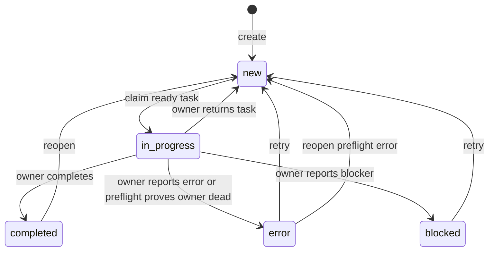

# Task state transitions

This describes the persisted `tasks.status` lifecycle in the current source
checkout. The CLI and TUI expose the transitions below; lifecycle changes and
their corresponding event records are committed together.

## Persisted states

| Status | Meaning |
| --- | --- |
| `new` | Waiting in the queue. Claimable when unarchived and all parent and prerequisite tasks are completed. |
| `in_progress` | Claimed by one session. This is the only status with a `claim_key`. |
| `completed` | Work is finished. It can be reopened. |
| `error` | Work failed or its owner was proven dead. A reason is stored as a message. |
| `blocked` | The owner reported that work cannot proceed. A reason is stored as a message. |

Queue diagnostics also use “blocked” for a `new` task that is not ready because
of unfinished dependencies. That diagnostic does not change the task's
persisted status.

## Why Reopen appears on a New task

The current Ctrl-G menu hides Reopen for `error` and `blocked`, but also shows it
for `new`. That visibility rule is broader than the valid transition: a New task
cannot reopen. Confirming it with either `y` or `Y` opens an action error and
leaves the task unchanged. This is a menu availability mismatch.

Use `qqq next` to claim a ready New task. Reopen returns previously started or
finished work to New; it does not start work or act as a New-to-New no-op.

## Normal lifecycle

| Transition | How it happens | Guard |
| --- | --- | --- |
| Create → `new` | `qqq add`, import, or recipe application | New tasks start unarchived and unassigned. |
| `new` → `in_progress` | `next` or a worker claims a task | The task must be unarchived and ready: its parent and every prerequisite are completed. |
| `in_progress` → `completed` | `qqq edit ID --complete` or TUI Complete | The CLI requires the current owner. TUI confirmation bypasses ownership checks. |
| `in_progress` → `new` | `qqq edit ID --set-pending` or `--set-status new` | The current owner must match; this releases the claim. |
| `in_progress` → `error` | `qqq edit ID --set-status error --reason TEXT` | The current owner must match and the reason must be nonblank. Owner preflight can also set `error` when it proves the claim owner is dead. |
| `in_progress` → `blocked` | `qqq edit ID --set-status blocked --reason TEXT` | The current owner must match and the reason must be nonblank. |
| `error` or `blocked` → `new` | `qqq edit ID --set-status new` or TUI Retry | No owner is required. The reason and prior history remain. |
| `completed` → `new` | `qqq edit ID --reopen` or TUI Reopen | The task must be unarchived. Reopening also checks unfinished archived dependencies. |
| `in_progress` → `new` via Reopen | `qqq edit ID --reopen` | The CLI requires the saved Herdr owner to be verified absent. TUI confirmation bypasses ownership checks. |
| Preflight `error` → `new` | `qqq edit ID --reopen` | Normal reopen accepts an error only when its latest relevant error event came from owner preflight. Use Retry for manually reported errors. |

## CLI action matrix

Each cell gives the resulting status for `qqq edit ID` with the column's option.
`Reject` means the requested transition fails. These rules assume a valid task
and any required reason, identity, archive and dependency checks.

| Current status | `--complete` | `--set-status new` | `--set-status error` | `--set-status blocked` | `--reopen` |
| --- | --- | --- | --- | --- | --- |
| `new` | Reject | Reject | Reject | Reject | Reject |
| `in_progress` | `completed`, owner | `new`, owner | `error`, owner | `blocked`, owner | `new`, absent owner |
| `completed` | Reject | Reject | Reject | Reject | `new` |
| `error` | Reject | `new` | Reject | Reject | `new` only for a preflight error |
| `blocked` | Reject | `new` | Reject | Reject | Reject |

Error and blocked reports require a nonblank `--reason`. Normal CLI reopen of an
active task must prove the saved Herdr owner absent; failed discovery is not proof.
A preflight error is eligible for normal reopen only when its latest event other
than archive/unarchive is an error recorded by owner preflight. Manually reported
errors use `--set-status new` to retry.

The CLI also accepts `qqq edit ID --set-status new --force` to return an
`in_progress`, `error`, or `blocked` task to `new` without matching its owner.
It still rejects `new` and `completed`; `--force` is invalid with other status
options. The CLI does not accept `--set-status in_progress` or
`--set-status completed`: claiming uses `next`, and completion uses `--complete`.

`next` claims only a ready, unarchived New task. When the caller already owns a
task, it returns that task without another claim event. It never directly claims
an Error, Blocked or Completed task; return or reopen that task to New first.

## Ctrl-G action matrix

This table describes the menu for the task's current status. `Hidden` means no
menu entry. `Shown, rejects` describes the New/Reopen mismatch above. Both `y`
and `Y` confirm the same forced action, with no owner or Herdr lookup.

| Current status | Complete (`c`) | Mark error (`e`) | Mark blocked (`b`) | Retry (`r`) | Reopen (`o`) |
| --- | --- | --- | --- | --- | --- |
| `new` | `completed` | `error` | Hidden | Hidden | Shown, rejects |
| `in_progress` | `completed` | `error` | `blocked` | Hidden | `new` |
| `completed` | Hidden | Hidden | Hidden | Hidden | `new` |
| `error` | `completed` | Hidden | Hidden | `new` | Hidden |
| `blocked` | `completed` | Hidden | Hidden | `new` | Hidden |

Mark error and Mark blocked require a nonblank reason. Successful transitions
clear active ownership while preserving assignment metadata and the saved Herdr
link. Clear assignment (`u`) separately clears the four displayed assignment
fields after confirmation; it does not change status, active ownership or the link.

## Unusual and rejected transitions

| Situation | Current behavior |
| --- | --- |
| New → Completed or Error | Ctrl-G permits manual completion/error without first claiming the task. Completion does not require dependencies to be ready. Normal CLI completion/error rejects New. |
| Error or Blocked → Completed | Ctrl-G Complete permits it; CLI `--complete` rejects it. |
| New → Blocked | Rejected by the CLI; Mark blocked is hidden in the TUI. A task must be in progress before it can be marked blocked. |
| New → New through Reopen or return-to-New | Rejected, including with `--force`. The visible TUI Reopen entry does not change this. |
| Completed → New through return/retry | CLI `--set-status new`, even with `--force`, rejects it. Use Reopen. TUI Retry is hidden. |
| Repeating completion, error or blocked reporting in the same state | Rejected. These lifecycle actions are not idempotent no-ops; unavailable TUI entries are hidden. |
| Forcing a live active task to New | TUI Reopen permits it. CLI normal reopen requires an absent owner; CLI `--set-status new --force` bypasses ownership. |
| Opening an action, then another worker changes the status | Confirmation uses the current database status. Force does not guarantee success: Complete rejects an already completed task, and Mark blocked requires it still be in progress. |
| A pending Mark error confirmation after another worker completes the task | Accepted: the underlying force-error operation also permits Completed → Error, although Mark error is hidden when opening the menu on a completed task. |
| A pending Reopen confirmation after the task becomes Error or Blocked | Accepted by the underlying force-reopen operation. Newly opened menus offer Retry for these states. |

Archived is independent of status. Archived New tasks cannot be claimed. Archive
is shown on active tasks but rejects them; an unfinished task with unarchived
unfinished dependents also cannot be archived. Reopen rejects archived tasks;
unarchive first, or combine CLI `--unarchive --reopen`. Forced Complete and Mark
error do not themselves unarchive a task. A completed or unarchived dependency
is available for reopening, but an archived unfinished parent or prerequisite
blocks it. Unfinished unarchived dependencies allow reopening to New and then
keep that task from being claimed until they finish.

Rejected mutations leave status, ownership, content and history unchanged.
Commands may first run owner preflight; that separate check can record an error
for a proven-dead owner before the requested action is evaluated.

The menu rules live in [src/tui/mod.rs](../src/tui/mod.rs)
(`action_menu_available`); transitions and their guards live in
[src/db.rs](../src/db.rs) (`claim`, `edit_guarded`, `force_complete`, `force_error`,
`force_blocked`, `reopen_task`) and [src/archive.rs](../src/archive.rs). CLI option
mapping is in [src/main.rs](../src/main.rs).

## Invariants and related fields

- `claim_key` is set only while status is `in_progress`; leaving that status
  clears it. The active claim is unique to one task.
- Claims, releases, completions, errors, blocked reports, and reopens append an
  event. Error and blocked reasons are also saved as task messages.
- Assignment metadata and the saved Herdr link remain after a task leaves
  `in_progress`; a new claim may replace the link.
- `archived` is independent of status. It does not create another lifecycle
  state, but archived tasks cannot be claimed and active tasks cannot be
  archived.
- Status transitions can be combined with supported direct edits; the status,
  event, and accompanying edits commit atomically.

For command syntax and TUI behavior, see the [command reference](reference.md),
especially [completion](reference.md#complete-work),
[reopening](reference.md#reopen-work),
[returning or retrying work](reference.md#return-or-retry-work), and
[action confirmations](reference.md#action-confirmations).
